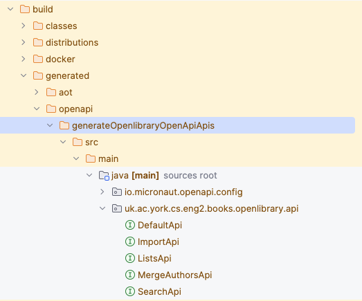

# Client generation

Before starting this section, you will need to have a solution to Practical 2.
You can use your own, or you can start from the [model solution of Practical 2](../../solutions/practical2.zip).

## Obtaining the OpenAPI specification

We want to integrate an external service to have better information about our books.
For this practical, we have chosen the [OpenLibrary API](https://openlibrary.org/developers/api), as they have an [OpenAPI sandbox](https://openlibrary.org/docs) that we can experiment with.

As a first step, visit their sandbox (see link above), and download the `/openapi.json` file linked from under the "Open Library API" header (it is also available directly from [https://openlibrary.org/openapi.json](https://openlibrary.org/openapi.json)).

Move and rename the `openapi.json` file to `src/main/openapi/openlibrary-1.0.0.json` in your project.

## Adding the Micronaut OpenAPI Gradle plugin

If we want to generate clients from the OpenLibrary OpenAPI spec, we will need to add the [Micronaut OpenAPI Gradle plugin](https://guides.micronaut.io/latest/micronaut-openapi-generator-client-gradle-java.html) to our `build.gradle`.

Open your `build.gradle` file, and add this line to the `plugins` section:

```groovy
id("io.micronaut.openapi") version "5.0.2"
```

## Configuring the Micronaut OpenAPI Gradle plugin

We also need to let the Micronaut OpenAPI Gradle know about the OpenLibrary spec.
Within the `micronaut` section of the `build.gradle` file, add this block:

```groovy
openapi {
  client("openlibrary", file("src/main/openapi/openlibrary-1.0.0.json")) {
    apiPackageName = "uk.ac.york.cs.eng2.books.openlibrary.api"
    modelPackageName = "uk.ac.york.cs.eng2.books.openlibrary.model"
    clientId = "openlibrary"
    useReactive = false
    nameMapping = ["num_found": "numFoundSnakeCase"]
  }
}
```

The `nameMapping` line works around a quirk of the OpenLibrary specification.
Its `SearchResponse` schema has both a `numFound` and a `num_found` property, which would both be turned into a `getNumFound()` method in Java, causing a compilation error.
`nameMapping` tells the generator to use a different Java name for `num_found`.

Save the file and reload all Gradle projects as we did [at the end of the first section of Practical 2](../micronaut-data/02-libraries.md#ready-to-move-on).

If you did it correctly, the "Gradle" drawer in IntelliJ should show a new "Tasks - micronaut openapi" folder.

Try running the `build` Gradle task.
You will see that a number of classes ending in `Api` were generated for us within the `build/generated/openapi` folder:



## Specifying the base URL of the OpenLibrary API

You may notice that we specified a `clientId` in the `openapi` block.
This allows us to configure the generated client from the `application.properties` files.

Specifically, we'll need to tell Micronaut how to access the OpenLibrary API.
Edit the `src/main/resources/application.properties` file, and add these lines:

```
micronaut.http.services.openlibrary.url=https://openlibrary.org
```

## Examining the generated code

Have a look through the generated code.
In this practical, we will use the `searchJsonSearchJsonGet` method in `SearchApi`, which invokes the [Search API](https://openlibrary.org/dev/docs/api/search) of OpenLibrary.
You will notice that it is rather unwieldy, as it has over 30 parameters (one per query parameter in the specification):

```java
@Get("/search.json")
SearchResponse searchJsonSearchJsonGet(
    @QueryValue(value = "limit", defaultValue = "100") @Nullable @Min(0) Integer limit,
    @QueryValue("offset") @Nullable @Min(0) Integer offset,
    @QueryValue("page") @Nullable @Min(1) Integer page,
    // ... many more parameters ...
    @QueryValue("isbn") @Nullable String isbn,
    @QueryValue("author") @Nullable String author,
    // ... and a few more ...
);
```

The Micronaut OpenAPI generator does not have an option to produce a more convenient API (e.g. a fluent builder) for these methods, so in the next section we will write a small wrapper ourselves.

You may also notice that while the method returns a `SearchResponse`, its `docs` property (which has the actual results) is just a `List<Map<String, Object>>`.
The OpenAPI specification does not describe the structure of each result in detail, so we will need to write some additional logic in our gateway that understands their format.
